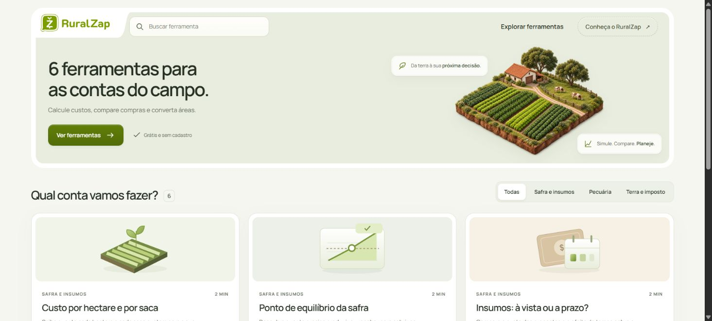

# RuralZap · A propriedade em perspectiva

**Padrão aprovado por Victor Hugo em 21/10/2026, versão 1.0.** Consolidação da direção profissional e das revisões das Ferramentas do campo. Victor aprovou o resultado final e pediu sua preservação como referência para o redesign, incluindo as ilustrações. Esta aprovação sucede as pendências estéticas intermediárias das calculadoras.

[Abrir demonstração preservada](demo/index.html) · [Tokens](tokens.json) · [Direção das ilustrações](ILUSTRACOES.md) · [Contratos e verificação](CONTRATOS.md) · [Receita para o redesign](REDESIGN.md)

## A linguagem
Agricultura com presença, ferramenta com clareza. Superfícies minerais quase brancas, oliva, linhas finas e relevo contido. Manrope organiza títulos, dados e apoios; a ilustração traz profundidade e expressão de marca sem ocupar a área de cálculo. A personalidade está na relação entre desenho, tarefa e conteúdo, não em slogans intercambiáveis.

| Papel | Decisão preservada |
|---|---|
| Fundo / texto | `#f5f6f0` / `#263023`; contraste e espaços agrupam conteúdo |
| Hero / menu | superfície `#e9eddf`, moldura branca; marca e recorte formam uma peça na abertura |
| Ações | oliva, gradiente muito discreto, borda e luz interna; secundárias claras |
| Campos A | superfície branca, rótulo flutuante na borda, unidade integrada, foco no próprio campo |
| Tipografia | Manrope local, pesos 400/500/600/700; hierarquia pelo tamanho, peso e proximidade |
| Dados | resultado principal evidente; métricas secundárias separadas por espaço e linhas |
| Ilustração | miniatura agrícola isométrica na entrada; objetos SVG com volume nas seis ferramentas |
| Rodapé | símbolo real do chat monocromático, assinatura compacta e agrupada |

Os valores de [tokens.json](tokens.json) documentam esta versão. A cascata completa está no demo; não copie uma declaração antiga de `styles.css` ignorando as revisões posteriores. Na integração, mapeie por função aos tokens oficiais do produto/reseller, preservando radius, modo escuro e componentes existentes.

## Composição que identifica o produto
O menu e a hero começam unidos. A hero permanece parada enquanto o catálogo sobe por cima. Quando a seção encontra de fato a base do menu, moldura, recorte e superfície interna assumem juntos o estado fechado: cantos arredondados simétricos, sem faixa verde sob a marca. A fluidez vem da rolagem; uma interpolação atrasada da forma recria o defeito rejeitado. O cabeçalho conserva identidade ao entrar nas ferramentas.

A busca fica no início da faixa verde, junto à marca. Em pouco espaço, uma lupa abre a busca sobre o cabeçalho. A apresentação usa a quantidade real de ferramentas e uma frase curta sobre o que fazem. Os apoios sobre a fazenda flutuam; não reservam outra faixa abaixo da arte.

No mobile, simplifique a composição: navegação compacta, formulário em sequência, rótulos de ação curtos e rodapé intencional. “Menos é mais” significa menos redundância e espaço desperdiçado, mantendo dados, compreensão e caminhos de acesso. Não é apenas reduzir o desktop.

Capturas complementares: [entrada em 390 px](evidencias/inicio-mobile-390.png), [calculadora em janela ampla](evidencias/safra-desktop.png) e [campos em 390 px](evidencias/safra-mobile-390.png). São capturas reais da revisão local, sem recompor a interface em uma imagem promocional.

## Precedência e uso
Este padrão orienta o redesign RuralZap. Não é tema obrigatório para outros produtos. Para o painel operacional, continuam válidos o template aprovado em 04/10 e suas exceções: preservar menus, capacidades, radius configurado, campos e tema/reseller do sistema. O cabeçalho público das calculadoras não substitui automaticamente o shell financeiro.

As escolhas rejeitadas ficam como histórico, não alternativas equivalentes: campos B escuros com destaque fora; faixa de legendas que aumentava a hero; slogans redundantes; linha verde sob o logo durante a mudança; menu com outra identidade nas ferramentas; avisos secundários em blocos grandes; comparação A com A sem aviso; CSV apresentado como relatório visual.

## Origem e direitos
Direção e aprovação: Victor Hugo. Implementação e consolidação: Aster/Codex, com sucessivas correções orientadas por Victor. As referências Zolve/Halo e Fertile/Halo orientaram relação entre objeto, domínio e composição; Klim orientou a união menu/hero. Consulte [o registro das referências](REFERENCIAS.md). Os pixels de terceiros não integram este padrão distribuído.

Farm PNG gerado para o projeto; miniaturas SVG escritas para a interface; marca RuralZap fornecida pelo projeto. Fontes e bibliotecas mantêm suas licenças em `demo/assets/` e `demo/vendor/`. Este registro não concede licença de uso da marca RuralZap a terceiros. O [manifesto](manifesto.json) identifica arquivos e hashes da versão preservada. A demonstração usa exemplos e armazenamento no navegador; não contém contas reais.

A aprovação é visual e funcional no contexto observado; não equivale a pesquisa com produtores, integração em produção ou certificação para todos os dispositivos. Os limites de verificação estão registrados separadamente dos critérios desejados.
