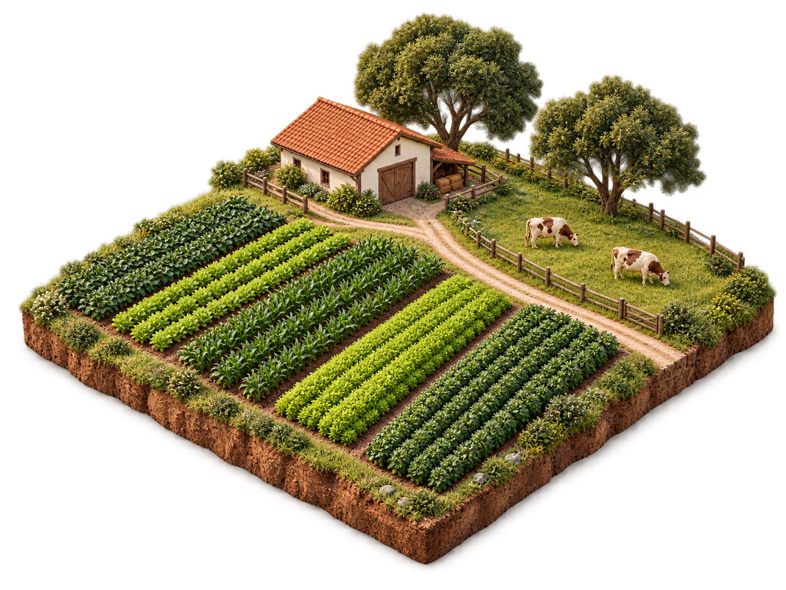

# Ilustrações RuralZap · receita para continuidade

## A arte aprovada

A imagem de entrada é um PNG com transparência, 1456 × 1088 px: terreno agrícola como miniatura isométrica, solo aparente na lateral, fileiras de culturas, caminho, casa clara com telhado de barro, árvores, cerca e gado. A textura é detalhada, com luz suave e escala de maquete. A composição tem base reconhecível, silhueta recortada e cores naturais. É uma imagem 2D com aparência de volume; não um modelo 3D interativo.

As seis miniaturas de ferramentas são **SVG desenhados em código**, com menos textura e mais síntese. Compartilham cores vegetais/terrosas, fundos claros, perspectiva e volume discreto. Não atribuir sua criação a um gerador de imagens. Os SVGs extraídos estão em [ilustracoes/](ilustracoes/): safra (canteiro e broto), equilíbrio (linha e ponto), compra (dinheiro e calendário), leite (garrafa e barras), áreas (terreno e medida), ITR (documento e verificação).

## Receita para gerar novas cenas
O prompt exato usado originalmente não foi recuperado. O texto abaixo é uma **receita consolidada a partir da arte aprovada**, não uma transcrição histórica. Use a fazenda como referência visual quando a ferramenta permitir; solicitar apenas “3D rural” não mantém esta direção.

> Crie uma ilustração para o RuralZap que represente [tarefa ou assunto]. Uma miniatura agrícola brasileira vista em perspectiva isométrica, com [objetos pertinentes], composição compacta e silhueta clara. Materiais naturais, vegetação em verdes oliva e folha, terra quente e detalhes de cerâmica ou madeira, luz diurna suave, volume delicado e textura artesanal realista. A imagem deve parecer uma pequena peça cuidadosamente construída. Preserve a escala de maquete, perspectiva, iluminação e densidade da referência aprovada. Fundo transparente, com sombra de contato contida e sem base gráfica adicional. Objeto inteiro, sem cortar a silhueta. Sem textos, letras, números, marca, legendas ou elementos de interface embutidos. Adeque a quantidade de detalhes à exibição em [tamanho/posição].

Adapte o assunto ao que a ferramenta faz: safras, leite, área, compra, documento. Não encha todas as imagens de casa, trator e vaca só por serem rurais. Uma peça deve explicar um tema. Para miniaturas muito pequenas, prefira o SVG sintético aprovado ou uma geração com poucos volumes; não reduza a fazenda inteira até seus detalhes virarem ruído.

## Direção de uma série
1. Defina função, assunto, proporção, tamanho de uso e recorte antes de gerar. Faça uma peça piloto usando a referência aprovada.
2. Preserve ponto de vista, direção da luz, escala aparente e intensidade da sombra. Cenas variam; gramática visual permanece.
3. Revise sobre fundo real da página, na escala final desktop/mobile. Verifique halo, bordas, recorte, contraste, peso visual, detalhes deformados e coerência dos objetos. Transparência deve existir no arquivo, não ser um quadriculado desenhado.
4. Registre ferramenta, prompt realmente usado, referência, data, dimensões e arquivo. Preserve o original; otimizações e recortes são derivados identificados. Comprima conforme a utilização, mantenha dimensões reservadas e alternativa textual pertinente.
5. Integre sem transformar arte em obstáculo à tarefa. Sem loops por padrão ou cena pesada no formulário. Não acrescentar “Ilustração conceitual” à interface decorativa sem necessidade ou solicitação; origem continua documentada aqui.

3D interativo é uma hipótese de estudo futuro. Antes de adotá-lo, demonstrar utilidade, orçamento de desempenho, interação por toque/teclado, alternativa estática e movimento reduzido. Não carregar WebGL apenas para reproduzir uma imagem que já cumpre seu papel.
